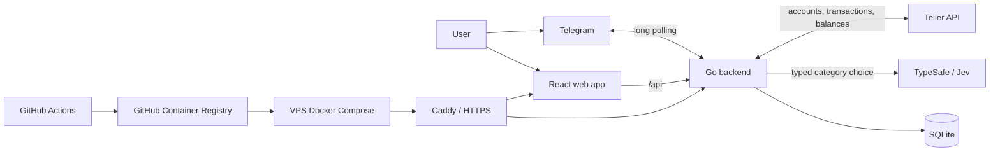

# Steer Architecture

Steer is a small, single-backend application. A Go process handles Telegram commands, Teller Connect completion, transaction synchronization, and scheduled SQLite backups. React provides the browser UI used during account connection.

## Telegram

- The backend uses Telegram long polling; there is no inbound Telegram webhook.
- `/connect` creates a short-lived, single-use Teller Connect session.
- Transaction-history commands read synchronized data from SQLite and request a live balance from Teller.
- A delivery worker sends newly settled, non-baseline transactions and then marks each successful notification `delivered`.

## Web application

- React and Vite build a static single-page application served by an unprivileged Nginx container.
- Teller Connect returns its signed completion data to `POST /api/teller/connect/complete`.
- The backend validates the signed enrollment, encrypts the Teller access token, and stores the initial posted-transaction baseline atomically.

## Backend services

- `bot`: Telegram command handlers and message formatting.
- `teller`: mutual-TLS Teller client, enrollment verification, token encryption, pagination, and transaction synchronization.
- `jev`: TypeSafe HTTP client that maps transactions to user-owned category choices.
- `storage`: SQLite repositories, versioned migrations, and backups.
- `TransactionPoller`: the in-memory scheduling worker.
- `TransactionCategorizationWorker`: bounded-concurrency transaction classification and category-memory application.
- `TransactionDeliveryWorker`: scheduled, bounded-concurrency Telegram notification delivery.

## Transaction polling

1. At startup, the worker loads connected user IDs from SQLite into an in-memory snapshot and immediately polls every user sequentially.
2. `TELLER_QUEUE_REFRESH_INTERVAL` replaces the entire snapshot so newly connected users are discovered without mutating the active list.
3. `TELLER_POLL_INTERVAL` polls the current snapshot. A failure for one user is logged and does not block the remaining users; the next scheduled cycle is the next attempt.
4. Each request re-fetches the inclusive `TELLER_SYNC_LOOKBACK_DAYS` window, follows Teller pagination, and upserts by Teller transaction ID.
5. Only Teller `posted` transactions are persisted by the polling path. Refunds are currently treated like any other posted transaction.

The polling queue is intentionally process-local and sequential for the expected private beta of at most 100 users. Restarting the process rebuilds it from SQLite.

## Transaction categorization

1. Users own their category names and descriptions. Categories have stable IDs so a later rename does not invalidate transaction assignments.
2. New posted transactions begin with `categorization_status=pending`. At startup and every `CATEGORIZATION_INTERVAL`, the worker loads batches of at most `CATEGORIZATION_CONCURRENCY` transactions.
3. An exact normalized transaction-name rule is applied without an external call. Otherwise, Jev receives the transaction fields and the user's complete category list as one TypeSafe Choice question with an explicit Uncategorized option.
4. Jev decisions below `JEV_CONFIDENCE_THRESHOLD`, explicit no-match decisions, and API failures are stored as `uncategorized`. They are never forced into a category.
5. A future user correction assigns the selected transaction, updates existing transactions with the same normalized name, and stores a rule for future matching transactions.

The TypeSafe request uses the API-required rolling Jev alias internally; there is no model configuration. The selected category, confidence, returned model build, probability distribution, and decision source are stored for auditability. Category-management and natural-language commands are a separate layer and are not part of this worker.

## Telegram notification delivery

1. At startup and every `TELEGRAM_DELIVERY_INTERVAL`, the worker queries non-baseline `settled` transactions whose categorization is complete, oldest-first.
2. Each query returns at most `TELEGRAM_DELIVERY_CONCURRENCY` rows, and the worker sends that batch concurrently before loading the next batch.
3. A successful Telegram send is conditionally marked `delivered`. A failed send remains `settled`, is skipped for the rest of that cycle, and becomes eligible on the next scheduled cycle.
4. Baseline transactions remain baseline during overlapping Teller upserts, so historical account data cannot become a new notification.

Delivery is at-least-once: if Telegram accepts a message but the database update fails, a later cycle can send the message again. This is acceptable for the private beta; exactly-once delivery would require a stronger outbox/idempotency design.

## Transaction state

- `provider_status` stores Teller's lifecycle value, such as `posted`.
- `delivery_status` is constrained to `settled` or `delivered`.
- `categorization_status` is constrained to `pending`, `categorized`, or `uncategorized`.
- A newly inserted posted transaction defaults to `settled`.
- Re-syncing an existing transaction updates Teller data without resetting an already `delivered` row.
- Teller's category remains separate from the user's category and is never overwritten by Jev or a manual correction.
- Notification delivery is independent from transaction polling and budget recalculation, but waits for categorization to finish.

## Data and security

- SQLite is the source of truth and runs versioned migrations during backend startup.
- Teller access tokens are encrypted with AES-GCM before storage; certificate and signing-key material come from environment configuration.
- The TypeSafe API key is server-side configuration and is never sent to the browser or stored in SQLite.
- Teller transaction IDs are primary keys, making overlapping polling windows idempotent.
- The backend creates periodic SQLite snapshots in the configured backup directory.

## Runtime and releases

- Local Docker Compose runs the backend, frontend, and same-origin Nginx gateway.
- Production images are built by GitHub Actions on pushes to `prod`, tagged with the Git commit SHA, and stored in GitHub Container Registry.
- Publishing and SSH deployment are disabled unless the repository variable `RELEASE_ENABLED` is `true`.
- The VPS release Compose file binds the backend and frontend to loopback ports. Caddy terminates HTTPS and routes `/api/*` to Go and all other traffic to React.
- Production and staging use separate URLs, environment files, ports, data, and bot/Teller credentials.
